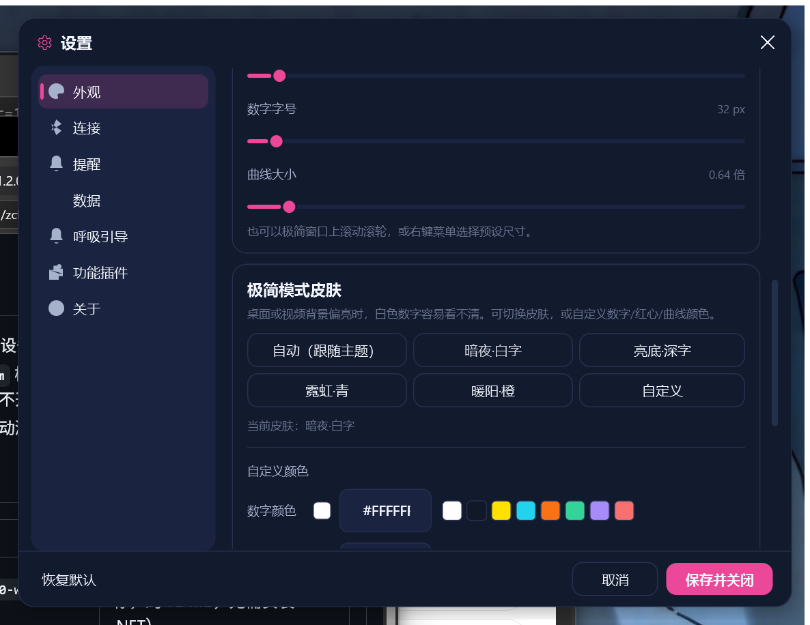

<div align="center">

# 华为手环心率实时监控 · Windows 桌面悬浮窗

**HeartRate Monitor** — 用蓝牙 BLE 连接华为手环 / 智能手表，把心率实时显示在桌面悬浮窗里。
支持心率广播（GATT `0x180D`）、心率趋势曲线、极简悬浮模式、窗口置顶、皮肤切换、开机自启与插件扩展。

[](https://github.com/zcfqx/HeartRate/releases/latest)
[](https://dotnet.microsoft.com/download/dotnet/8.0)
[](https://www.microsoft.com/windows)
[]()
[](LICENSE)

[下载](#下载) · [功能](#功能) · [截图](#界面预览) · [使用](#快速开始) · [开发](#开发) · [常见问题](#常见问题) · [文档](#文档)

</div>

---

## 下载

前往 **[Releases](https://github.com/zcfqx/HeartRate/releases/latest)** 下载 Windows 64 位单文件 exe：

| 版本 | 大小 | 说明 |
| --- | --- | --- |
| `HeartRate-v*-win-x64-self-contained.exe` | ≈ 75 MB | **推荐**，免安装 .NET 运行时，双击即用 |
| `HeartRate-v*-win-x64-framework-dependent.exe` | ≈ 28 MB | 需先安装 [.NET 8 Desktop Runtime](https://dotnet.microsoft.com/download/dotnet/8.0) |

系统要求：Windows 10（build 19041+）/ Windows 11、支持 BLE 4.0+ 的蓝牙适配器。无需安装、无网络请求，数据只保存在本机。

---

## 功能

- **华为手环 / 手表心率实时显示** — 基于标准蓝牙心率服务（GATT `0x180D` / 心率测量特征值 `0x2A37`），兼容开启「心率广播」的华为手环、智能手表及其他支持标准心率服务的 BLE 设备
- **桌面悬浮窗** — 无边框圆角、始终置顶（可开关）、可拖动、可调宽度和不透明度（0% 时背景全透明，只留数字与图形）
- **心率趋势曲线** — 自绘平滑曲线，**鼠标悬停即可查看任意数据点的 BPM 与时间**
- **极简模式** — 只显示心跳图标 + 大号心率数字，`Ctrl+M` / 顶栏按钮 / 托盘菜单一键切换；**心形、数字、曲线大小均可调节**（设置滑块、右键预设、滚轮三处入口）
- **皮肤与配色** — 极简模式可切换 6 套皮肤（跟随主题 / 暗夜白字 / 亮底深字 / 霓虹青 / 暖阳橙 / 自定义），并分别自定义数字、心形、曲线颜色与文字阴影；亮色桌面、视频背景上也能看清数字
- **启动自动连接** — 记住上次连接的手环，应用打开后自动扫描并连接（最多两次，约 40 秒），无需手动点扫描
- **设备扫描** — 默认仅显示心率设备并按「心率优先 + 信号强度」排序；匿名广播的「心率传感器」会自动升级为真实名称；扫描失败会给出明确原因
- **会话统计** — 当前 / 平均 / 最高 / 最低心率、心率区间（放松 / 燃脂 / 有氧 / 无氧 / 极限）、RR 间期、卡路里估算、会话时长
- **提醒与数据** — 心率上下限通知与声音提醒；SQLite 本地记录、按天数自动清理
- **托盘与单实例** — 关闭默认最小化到托盘；重复启动会唤起已有窗口，僵尸进程会被自动清理
- **插件化** — 组件卡片、设置页、托盘命令三类扩展点，内置 4 个插件 + 可加载外部插件

---

## 界面预览

| 主悬浮窗 | 极简模式 | 极简模式（亮底皮肤） |
| --- | --- | --- |
|  |  |  |
| 心率 / 趋势 / 会话统计 / 设备连接组件 | 心形 + 大号数字 + 趋势曲线 | 亮色桌面或视频上自动换成深色数字 |

| 设置中心 | 极简模式皮肤设置 | 趋势曲线悬停 |
| --- | --- | --- |
|  |  |  |
| 深色 / 浅色主题、强调色 | 皮肤预设 + 自定义数字/心形/曲线颜色 | 悬停查看数据点 BPM 与时间 |

---

## 快速开始

1. **开启手环的心率广播**：华为手环进入「运动模式」，或在手环设置中开启「心率广播」（普通待机状态通常不会广播标准心率服务）。
2. **运行** `HeartRate-v*-win-x64-self-contained.exe`。
3. 首次使用：在「设备连接」卡片点 **扫描**，在列表中选择你的手环 → 连接成功后即可看到实时心率。
4. 之后打开应用会**自动连接上次使用的手环**；配置在 `设置 → 连接` 中可关闭。

> 首次运行如果扫描不到设备，请先确认手环已开启心率广播，详见 [常见问题](#常见问题)。

### 常用操作

| 操作 | 说明 |
| --- | --- |
| 拖动顶栏 | 移动悬浮窗，位置自动记忆 |
| 顶栏 ⤢ / `Ctrl+M` / 托盘菜单 | 切换极简模式 |
| 极简窗口内双击 | 退出极简模式 |
| 极简窗口内滚轮 | 等比缩放心形、数字、曲线 |
| 极简窗口内右键 | 显示曲线、尺寸预设、窗口置顶、皮肤、背景不透明度、设置等 |
| 看板空白处右键 | 窗口置顶、设置、关闭到托盘 |
| 托盘图标 | 左键显示/隐藏窗口，右键更多菜单 |

---

## 极简模式与皮肤

极简模式适合把心率长期贴在桌面角落或叠在视频上：

- **尺寸**：设置 → 外观 → 极简模式尺寸（心形 0.6–2.0 倍、字号 28–120 px、曲线 0.5–2.5 倍）；也可在极简窗口滚动滚轮，或右键 →「尺寸」选择紧凑 / 标准 / 大 / 特大
- **皮肤**：右键 →「皮肤」，或设置 → 外观 → 极简模式皮肤
  - 跟随主题：深色主题用白字红心，浅色主题自动换深灰字
  - 暗夜·白字 / 亮底·深字 / 霓虹·青 / 暖阳·橙：适合不同桌面背景
  - 自定义：分别填写数字、心形、曲线颜色（`#RRGGBB`），可加文字阴影，亮色背景上建议搭配阴影
- **背景**：右键菜单可一键切换 100% / 90% / 80% / 完全透明；0% 时窗口仍可拖动和右键

---

## 配置

配置保存在 SQLite 的 `Settings` 表（`%LOCALAPPDATA%\HeartRateMonitor\heartrate.db`），主要键：

| 配置项 | 默认值 | 说明 |
| --- | --- | --- |
| `Theme` / `AccentColor` | `Dark` / `#6366F1` | 界面主题与强调色（8 种预设） |
| `OverlayOpacity` | `1.0` | 悬浮窗不透明度，0 = 背景全透明 |
| `WindowWidth` | `320` | 悬浮窗宽度 280–520 |
| `WindowTopmost` | `true` | 窗口置顶开关 |
| `MinimalMode` / `MinimalShowChart` | `false` / `true` | 极简模式与趋势曲线 |
| `MinimalHeartSize` / `MinimalBpmFontSize` / `MinimalChartScale` | `1.0` / `56` / `1.0` | 极简模式尺寸 |
| `MinimalSkin` | `Dark` | 极简皮肤：`Auto` / `Dark` / `Light` / `Neon` / `Warm` / `Custom` |
| `MinimalTextColor` / `MinimalHeartColor` / `MinimalChartColor` | `#FFFFFF` / `#FF3B5C` / `#FF3B5C` | 自定义颜色 |
| `AutoConnect` / `LastDeviceId` | `true` / — | 启动自动连接上次设备 |
| `MinimizeToTray` / `StartWithWindows` | `true` / `false` | 关闭到托盘 / 开机自启 |
| `HighHeartRateThreshold` / `LowHeartRateThreshold` | `160` / `50` | 心率提醒阈值 |

数据与日志：`%LOCALAPPDATA%\HeartRateMonitor\`（`heartrate.db`、`logs\app-yyyyMMdd.log`、`plugins\`）。

---

## 开发

### 构建与测试

```bash
git clone https://github.com/zcfqx/HeartRate.git
cd HeartRate

dotnet build src/HeartRateMonitor.sln -c Debug
dotnet test  src/HeartRateMonitor.sln -c Debug
```

> 受限沙箱中若 `dotnet build` 在还原后无输出失败，追加 `-m:1 -p:BuildInParallel=false` 重试。

### 发布

```bash
# 框架依赖单文件（≈28 MB，需 .NET 8 Desktop Runtime）
dotnet publish src/HeartRateMonitor.App/HeartRateMonitor.App.csproj -c Release -r win-x64 `
  --self-contained false -p:PublishSingleFile=true -o publish/framework-dependent

# 自包含单文件（≈75 MB，免运行时）
dotnet publish src/HeartRateMonitor.App/HeartRateMonitor.App.csproj -c Release -r win-x64 `
  --self-contained true -p:PublishSingleFile=true -p:EnableCompressionInSingleFile=true -o publish/self-contained
```

界面冒烟检查与截图渲染：`dotnet run --project tools/HeartRateMonitor.UiSmoke`（运行前先退出正在运行的应用）。

### 技术栈与结构

WPF / .NET 8、CommunityToolkit.Mvvm、Windows BLE API、SQLite + Dapper、自研 `Sparkline` 曲线、自研 Win32 托盘与文件日志（无 SkiaSharp / Serilog / 第三方托盘库）。

```
src/
├── HeartRateMonitor.App/            # WPF 主程序：Views / ViewModels / Widgets / Infrastructure
├── HeartRateMonitor.Extensibility/  # 插件契约
├── HeartRateMonitor.Services/       # BLE、心率会话、设置、日志
├── HeartRateMonitor.Data/           # SQLite + Dapper
└── HeartRateMonitor.Core/           # 领域模型与接口
samples/Breathing/                   # 外部插件示例（呼吸引导）
tests/HeartRateMonitor.Tests/        # 94 个单元测试
tools/HeartRateMonitor.UiSmoke/      # 界面冒烟 + 截图渲染
```

### 插件

插件放在 `%LOCALAPPDATA%\HeartRateMonitor\plugins\<插件名>\`（`plugin.json` + dll），可向宿主贡献组件、设置页、托盘命令。
完整教程与最小示例见 [docs/PLUGIN-DEVELOPMENT.md](docs/PLUGIN-DEVELOPMENT.md) 与 [samples/Breathing](samples/Breathing)。

---

## 常见问题

**扫描不到手环？**

1. 确认手环已进入运动模式或开启「心率广播」——大多数手环待机时不广播标准心率服务；
2. 设备列表默认只显示心率设备，点卡片右上角的筛选按钮可显示全部 BLE 设备；
3. 仍在列表里看不到时，查看日志 `%LOCALAPPDATA%\HeartRateMonitor\logs\app-yyyyMMdd.log` 中的 `发现设备:` 行；
4. 华为手环常以匿名包「心率传感器」广播，随后自动显示真实名称，直接点击即可连接。

**数字在亮色背景上看不清？**

右键极简窗口 →「皮肤」选「亮底·深字」或「自定义」，也可以给数字加文字阴影；或把不透明度调到 90%/80% 让悬浮窗带一点底色。

**打开后没有自动连接？**

确认 `设置 → 连接 → 启动时自动连接上次设备` 已开启，且手环已开启心率广播；也可以在设备组件手动点扫描。

**关不掉 / 重复启动提示已在运行？**

应用默认关闭到托盘：右键托盘图标 → 退出。重复启动会唤起已有窗口；若进程卡死可执行
`Get-Process HeartRateMonitor.App -ErrorAction SilentlyContinue | Stop-Process -Force`。
启动各阶段日志在 `%LOCALAPPDATA%\HeartRateMonitor\startup.log`。

---

## 文档

| 文档 | 内容 |
| --- | --- |
| [docs/PLUGIN-DEVELOPMENT.md](docs/PLUGIN-DEVELOPMENT.md) | 插件开发指南：契约、清单、生命周期、隔离、调试 |
| [docs/UI-REDESIGN.md](docs/UI-REDESIGN.md) | 界面重构说明：布局、主题、组件模型、交互 |
| [docs/01_架构设计文档.md](docs/01_架构设计文档.md) | 分层架构与服务职责 |
| [docs/04_数据库设计文档.md](docs/04_数据库设计文档.md) | SQLite 表结构与仓储 |
| [docs/05_BLE通信设计文档.md](docs/05_BLE通信设计文档.md) | BLE 连接与心率数据解析 |

---

## 许可证

[MIT License](LICENSE)。欢迎提交 Issue / PR：

1. Fork 并创建分支：`git checkout -b feature/amazing-feature`
2. 提交遵循 [Conventional Commits](https://www.conventionalcommits.org/)：`feat:` / `fix:` / `docs:` / `refactor:` / `test:` / `chore:`
3. 确保 `dotnet build` 与 `dotnet test` 通过，新功能附带单元测试
4. 提交 Pull Request 并说明动机与改动

---

## 致谢

- [Bluetooth Heart Rate Profile Specification](https://www.bluetooth.com/specifications/specs/heart-rate-profile-1-0/) — Bluetooth SIG 标准心率服务
- [Windows BLE API](https://learn.microsoft.com/en-us/uwp/api/windows.devices.bluetooth) · [.NET 8](https://dotnet.microsoft.com/download/dotnet/8.0)
- [CommunityToolkit.Mvvm](https://github.com/CommunityToolkit/dotnet) · [Dapper](https://github.com/DapperLib/Dapper) · [Segoe Fluent Icons](https://learn.microsoft.com/windows/apps/design/style/segoe-fluent-icons-font)
