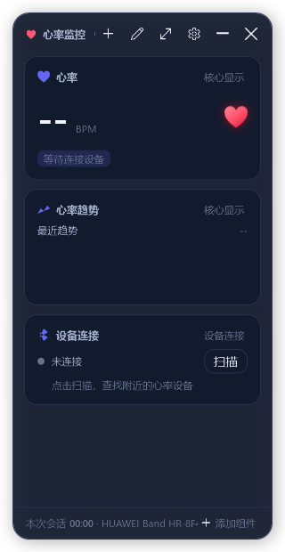
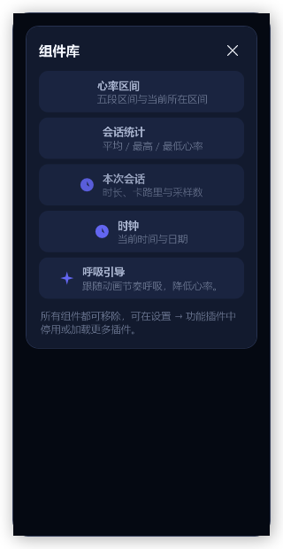
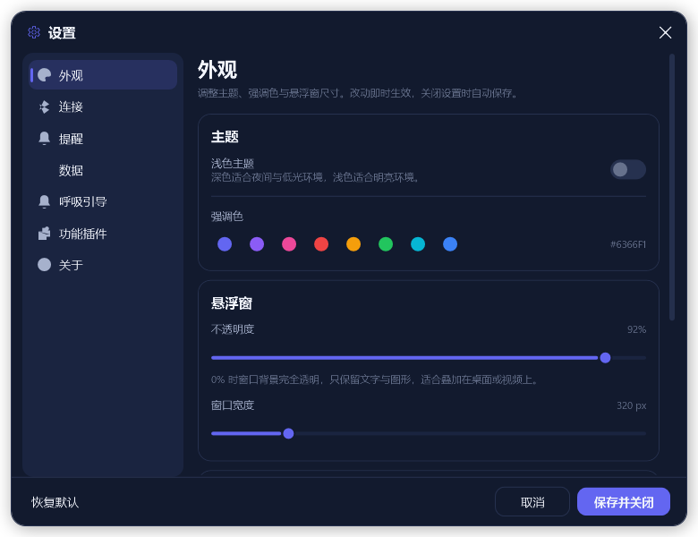
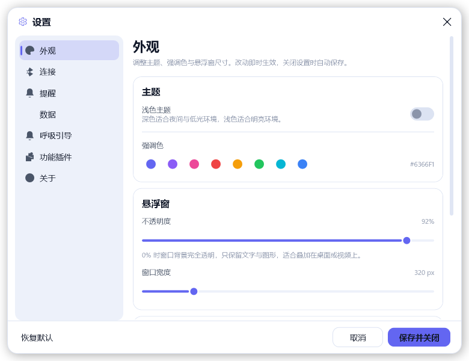
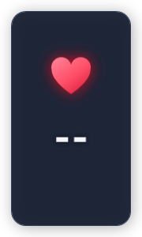
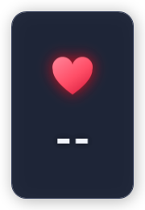
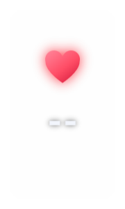
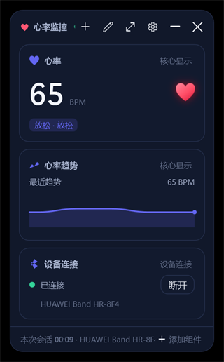
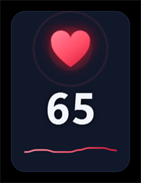

# 界面重构说明（v2 UI Redesign）

> 适用版本：HeartRate Monitor v2。本文记录 v2 界面重构的设计目标、视觉规范、信息架构、交互行为与实现落点。
> 相关文档：[插件开发指南](PLUGIN-DEVELOPMENT.md) · [README](../README.md)

---

## 1. 为什么要重构

v1 的界面是一个 **固定 280×280 的悬浮小窗**：顶部标题栏、中间 LiveCharts2 折线图、
底部三个 Tab 在「心率 / 设备 / 设置」面板之间切换，设备列表另开一个模态 `DevicePickerWindow`。
它有三个结构性问题：

1. **功能写死在窗口里**。心率、图表、设备、设置都是硬编码的面板，想加一个「本次会话统计」或
   「呼吸引导」只能改 `MainWindow.xaml` 和 `MainViewModel`（v1 已有 735 行）。
2. **显示空间固定且不可配置**。280×280 只能看一个数字加一条小曲线，用户无法决定看什么、看多大。
3. **依赖沉重**。LiveCharts2 + SkiaSharp 只为了画一条 60px 高的折线，却带来数十 MB 依赖
   （SkiaSharp 58.8MB、SkiaSharp.NativeAssets.Win32 70.5MB 的包体积）。

v2 的重构目标是：**看板化（widget dashboard）+ 插件化 + 轻量自绘 + 双主题**。

| 维度 | v1 | v2 |
|------|----|----|
| 窗口 | 固定 280×280 悬浮球 | 320px 默认宽、可 280–520 调宽、高度自适应内容，无边框圆角悬浮窗 |
| 内容组织 | 硬编码图表/设备/设置三个面板 | 可增删的**组件看板**（列表式），组件由插件提供 |
| 图表 | LiveCharts2 + SkiaSharp | 自绘 `Sparkline`（`FrameworkElement` + `StreamGeometry`） |
| 主题 | 单套深色，Theme.xaml 颜色固定 | Dark / Light 双主题 + 8 种强调色运行时可换 |
| 设置 | 独立 SettingsWindow（单页滚动） | 左侧导航 + 右侧内容页（外观/连接/提醒/数据/插件/关于） |
| 设备 | 模态 DevicePickerWindow | 内嵌「设备连接」组件（扫描/连接/断开不弹窗） |
| 日志 | Serilog 文件 sink | 内置 `FileLogger`（按天滚动、4MB 轮转、保留 7 天） |
| 托盘 | 引用了 Hardcodet 但未实现 | 自研 Win32 `Shell_NotifyIcon` 托盘（含插件命令菜单） |
| 第三方依赖 | LiveCharts、Serilog、Hardcodet、Extensions.Hosting | 仅 CommunityToolkit.Mvvm + Microsoft.Extensions.DependencyInjection |
| 体积 | framework-dependent 36.0MB；self-contained ≈99MB | FD 28.1MB（-22%）；SC 压缩 75.3MB + 原生库 ≈85MB |

---

## 2. 截图

| 主窗口（深色） | 组件库浮层 |
|:---:|:---:|
|  |  |

| 设置中心（深色） | 设置中心（浅色） |
|:---:|:---:|
|  |  |

| 极简模式（带曲线） | 极简模式（无曲线） | 极简模式（背景 0% 透明） |
|:---:|:---:|:---:|
|  |  |  |

| 实机连接（看板） | 极简模式（实机连接） |
|:---:|:---:|
|  |  |

> 截图由仓库内 `tools/HeartRateMonitor.UiSmoke` 渲染（`RenderTargetBitmap`，非系统截图），与真实运行效果一致。
> 重新生成：先退出正在运行的应用（单实例），再执行 `dotnet run --project tools/HeartRateMonitor.UiSmoke`；
> 该命令同时执行主题、插件启停、组件增删、极简模式与 0% 透明等界面冒烟检查。
> `main-connected.png` / `main-minimal-connected.png` 为连接真实手环（HUAWEI Band HR-8F4）时的运行时截图。

---

## 3. 视觉规范

设计语言：**深色优先的悬浮卡片**，低饱和蓝紫背景 + 单一强调色 + 大圆角 + 细边框 + 柔和外阴影。
所有颜色、字号、圆角均来自资源字典，不在视图里写死。

### 3.1 色板

| 语义键 | Dark | Light | 用途 |
|--------|------|-------|------|
| `Color.Background` / `Brush.Background` | `#0A0F1E` | `#F3F5FB` | 窗口外底色 |
| `Color.Surface` / `Brush.Surface` | `#121A2E` | `#FFFFFF` | 主卡片/悬浮窗本体 |
| `SurfaceAlt` | `#1A2440` | `#EDF1FA` | 次级卡片、输入框、按下态 |
| `Border` | `#26314F` | `#DCE3F2` | 1px 描边 |
| `Text` | `#F2F5FC` | `#131A2B` | 主文字 |
| `TextSecondary` | `#A6B1CC` | `#4A5568` | 说明文字 |
| `TextMuted` | `#66718C` | `#8B95AB` | 弱化/占位 |
| `Success` | `#34D399` | `#059669` | 已连接状态点 |
| `Warning` | `#FBBF24` | `#D97706` | 扫描/连接中 |
| `Danger` | `#F87171` | `#DC2626` | 断开、错误、移除 |
| `DangerSoft` | `#33F87171` | `#22DC2626` | 危险按钮 hover 底 |
| `Grid` | `#1E2942` | `#E5EAF5` | 分隔线/图表网格 |
| `Overlay` | `#050912` | `#EAEEF8` | 抽屉/浮层遮罩 |
| `Color.Heart` / `Brush.Heart` | `#FF5773` | `#E11D48` | 心跳图标、极简模式光环描边（固定语义色，不随强调色变化） |
| `Color.HeartSoft` / `Brush.HeartSoft` | `#33FF5773` | `#22E11D48` | 心跳光环填充 |
| `Brush.HeartGradient` | `#FF8095 → #FF4D66 → #D91E3F` | `#FF6B81 → #E11D48 → #BE123C` | 心跳图标渐变填充、极简曲线描边 |

强调色不是固定键，而是由 `ThemeManager` 在运行时**计算并注入**：

| 生成键 | 规则 | 用途 |
|--------|------|------|
| `Color.Accent` / `Brush.Accent` | 用户选择的十六进制色 | 主按钮、滑杆、选中导航条、图表线 |
| `Brush.AccentSoft` | 同色 + alpha `0x2E` | 选中背景、图表面积填充、chip 底 |
| `Brush.AccentDeep` | RGB × 0.78 | 强调色按下态/深色变体 |
| `Brush.OnAccent` | 亮度 > 170 用 `#11141E`，否则白 | 强调色上的文字 |

预设强调色（设置 → 外观）：`#6366F1` `#8B5CF6` `#EC4899` `#EF4444` `#F59E0B` `#22C55E` `#06B6D4` `#3B82F6`，默认 `#6366F1`。

心率数值与区间颜色复用统一分区表（`HeartRateZones`，见 README 心率区间表）：
放松 `#6366F1`、燃脂 `#22C55E`、有氧 `#F59E0B`、无氧 `#F97316`、极限 `#EF4444`。

### 3.2 字体与字号

字体链：`Segoe UI Variable Text` → `Microsoft YaHei UI` → `Segoe UI`（`Font.Body`）；
数值用 `Font.Display`（同链，偏几何感）；图标字体 `Segoe Fluent Icons` → `Segoe MDL2 Assets`（`Font.Icon`）。

| 样式键 | 字号/字重 | 用途 |
|--------|-----------|------|
| `Text.H1` | 22 SemiBold | 设置页标题 |
| `Text.H2` | 15 SemiBold | 卡片标题、分组标题 |
| `Text.Label` | 12 | 设置项名称 |
| `Text.Caption` | 11, `TextMuted` | 说明、插件名 |
| `Text.Value` | 26 SemiBold | 卡片内主数值 |

### 3.3 形状与间距

- 悬浮窗：外框圆角 **18px**，外边距 14px（给阴影留空间），`DropShadowEffect` BlurRadius 28。
- 设置窗：圆角 16px，外边距 12px，尺寸 780×600。
- 卡片：`Card`＝圆角 14、内边距 14、`Surface` 底 + 1px `Border`；卡片内嵌套 `Card.Inner`＝圆角 10。
- 按钮：圆角 10；主按钮 `Button.Primary`、次按钮 `Button.Ghost`、描边 `Button.Outline`、图标按钮 `Button.Icon`（30×30）。
- 开关：`Switch`（ToggleButton，40×22，选中轨道为强调色）。
- 滚动条：8px 细滚动条，无箭头，hover 加深。
- 列表：`ListBox.Clean` / `ListBoxItem.Clean`（透明底、选中用强调色 2px 左侧条 `NavItem`）。

---

## 4. 主窗口信息架构

```
┌─────────────────────────────────────────┐  ← 无边框圆角悬浮窗（320px 默认宽）
│ ♥  心率监控   ● 未连接   ＋  ✎  ⚙  —  ✕ │  ← 46px 顶栏
├─────────────────────────────────────────┤
│ ┌─────────────────────────────────────┐ │
│ │ ♥ 心率                    核心显示 │ │  ← 组件卡片：图标 + 标题 + 插件名
│ │ 72  BPM              ♡（脉冲）      │ │
│ │ [燃脂 · 100-139]                    │ │
│ └─────────────────────────────────────┘ │
│ ┌─────────────────────────────────────┐ │
│ │ 📈 心率趋势               核心显示 │ │
│ │ 最近趋势                      78    │ │
│ │ ╱╲╱╲╱╲（Sparkline 自绘）           │ │
│ └─────────────────────────────────────┘ │
│ ┌─────────────────────────────────────┐ │
│ │ 设备连接                    设备连接 │ │
│ │ ● 未连接            [扫描]          │ │
│ └─────────────────────────────────────┘ │
├─────────────────────────────────────────┤
│ 本次会话 00:00 · Polar H10   ＋ 添加组件 │  ← 底部状态栏
└─────────────────────────────────────────┘
```

### 顶栏元素

| 元素 | 行为 |
|------|------|
| ♥ + 标题「心率监控」 | 拖动窗口（`MouseLeftButtonDown → DragMove`） |
| 状态点 + 文案 | 由 `MainViewModel.ConnectionState` 决定：已连接=绿、扫描/连接/重连中=黄、未连接=灰；文案显示设备名或状态 |
| ＋（E710） | 打开/关闭「组件库」浮层 |
| ✎（E70F） | 切换编辑模式（激活时图标变强调色，卡片显示移除按钮） |
| ⤢（E740） | 切换极简模式（等价于 `Ctrl+M`、托盘菜单「极简模式」、设置 → 外观开关） |
| ⚙（E713） | 打开设置中心（`IDialogService.ShowSettingsDialog()`） |
| —（E921） | 最小化（不退出；由系统任务栏接管） |
| ✕（E8BB） | 关闭；若 `MinimizeToTray=true` 则隐藏到托盘，否则退出应用 |

### 组件看板

- 每个组件渲染为一张卡片，宿主统一提供外壳：左上图标、标题、右上插件名、编辑态的移除按钮（E74D），
  卡片主体由插件 `CreateView` 生成（见[插件开发指南](PLUGIN-DEVELOPMENT.md)）。
- 布局按组件 Id 的**有序列表**持久化到设置项 `Widgets`（JSON 数组），启动时先按保存顺序恢复；
  保存的 Id 若已不存在（插件被禁用/卸载）则跳过。
- 删除组件：进入编辑模式（✎）→ 卡片右上出现移除按钮 → 点击立即从看板与持久化列表移除。
- 添加组件：点 ＋ 打开「组件库」浮层，列出当前插件提供、且尚未放进看板的组件；
  点条目即添加并关闭浮层；全部已添加时显示「组件库已全部添加到看板」。
- 空看板：当所有组件被移除时显示空态提示（引导从组件库添加）。
- 组件顺序即添加顺序；`WidgetDescriptor.Order` 只决定组件库里的排序，不改动已有看板顺序。

### 底部状态栏

左侧：「本次会话 hh:mm:ss」+ 当前设备名；右侧「＋ 添加组件」快捷入口。
时长来自 `IHeartRateSession.Duration`，由 1s `DispatcherTimer` 刷新；未开始显示 `00:00`。

### 设备连接组件（v2.2 重做）

```
┌──────────────────────────────────┐
│ 设备连接                   设备连接 │
│ ● 扫描中…                  [停止] │
│ 点击下方设备即可连接               │
│ ┌──────────────────────────────┐ │
│ │ 已发现 1 台 · 搜索中 [仅心率设备] │ │
│ │ ♥ HUAWEI Band HR-8F4  -64 dBm │ │
│ └──────────────────────────────┘ │
└──────────────────────────────────┘
```

- 扫描结果按 `BleAdvertisementRules.SortForDisplay` 排序：心率设备优先 → 信号强度降序 → 名称；
- 默认开启「仅心率设备」筛选（隐藏耳机、触控笔等只广播名称的设备），关闭后显示全部周边设备；
- 设备名会随后续广播原地升级：匿名心率广播先显示「心率传感器」，拿到真实名称后经
  `IBleService.DeviceUpdated` 更新，不再新建设备行；
- 空态分三种：搜索中提示、未发现设备（提示确认手环处于心率广播模式）、被筛选隐藏的数量提示；
- 列表限高 172px 内部滚动；连接成功后自动收起，状态点转绿并显示设备名；
- v2.2 修复：此前 `_deviceList` 构造时被设为 `Collapsed` 且再未显示，导致扫描到了设备也「看不到」——这是
  「扫描不到设备」的真正原因，与 BLE 广播链路无关（日志可正常看到 `发现设备:`）。

### 内置组件（4 个内置插件共 7 个组件）

| 组件 Id | 标题 | 插件 | 默认显示 | 内容 |
|---------|------|------|:---:|------|
| `bpm` | 心率 | core | ✅ | 大号 BPM 数值、单位、心跳脉冲动画、当前区间 chip |
| `chart` | 心率趋势 | core | ✅ | `Sparkline` 240 点折线 + 面积填充、当前值、自动量程 |
| `zone` | 心率区间 | core | — | 五段区间横条（当前区间高亮） |
| `device` | 设备连接 | device | ✅ | 状态点、扫描/停止/断开；发现设备列表内嵌（默认「仅心率设备」筛选、心率优先 + 信号排序、名称自动升级），扫描中的计数与空态提示 |
| `stats` | 会话统计 | session | — | 平均/最高/最低心率、当前区间 |
| `session` | 本次会话 | session | — | 时长、卡路里、采样数、「开始新会话」 |
| `clock` | 时钟 | extras | — | HH:mm + 日期 |

默认看板 = `bpm` + `chart` + `device`。

### 交互细节

- **心跳动画**：BPM 卡片心形图标改为红色实心（`Brush.HeartGradient` + 红色辉光），
  按 `clamp(60 / bpm, 0.4, 1.6)` 秒半周期缩放（`ScaleTransform`，`DoubleAnimation` 自动反转）；暂停/无数据时停止。
  区间颜色只用于区间 chip，不再给心跳图标染色——红色是心率的固定语义色。
- **脉冲与数据节流**：`HeartRateSession` 在 UI 线程 `Post` 事件（构造时捕获 `SynchronizationContext`），
  避免每个组件各自 `Dispatcher.Invoke`；采样入环形缓冲（240 点），统计增量更新。
- **窗口行为**：位置保存到 `WindowLeft/WindowTop`；宽度来自设置 `WindowWidth`（Clamp 280–520）；
  背景不透明度来自 `OverlayOpacity`（**0.0–1.0**，v2.1 起作用于外壳 Border 背景画刷的 alpha，而不是 `Opacity`），
  调到 0 时背景完全透明且自动去掉阴影、命中测试 alpha 保留 1/255（否则分层窗口会整窗鼠标穿透）；
  修改后即时生效（订阅 `ISettingsService.SettingsChanged`）。
- **关闭**：`MinimizeToTray=true` → `Hide()` + 托盘图标；`false` → `App.ExitApp()`。
- **拖拽**：仅顶栏（极简模式下整窗）可拖动；拖动结束保存位置（设置窗关闭/应用退出时统一 `SaveAsync` 落库）。
- **单实例（v2.1）**：命名 Mutex `Local\HeartRateMonitor.SingleInstance` + 两个命名事件
  （`Local\HeartRateMonitor.Activate` / `ActivateAck`）。二次启动时新进程发激活信号并等待回执，
  已有实例由后台监听线程收到后 `ShowMainWindow()` 把窗口叫出来；3 秒无回执则判定旧实例卡死，
  自动 `Kill` 同路径（必要时同名）进程、重建 Mutex 后继续启动；只有接管失败才弹「已经在运行」。
  启动日志每行带进程号，便于区分多实例。

### 极简模式（v2.1 重新设计）

```
        ╭─────╮
        │  ♥  │   ← 红色渐变实心心形：外发光 + 双层光环 + 按心率节拍缩放
        ╰─────╯
          72      ← 大号数字（未连接显示 --），带黑色投影，0% 透明时也可读
        ╱╲╱╲╱╲   ← 可选：趋势曲线（MinimalShowChart，红色描边）
   180×约 233，无边框、置顶、可拖动，背景可完全透明
```

设计意图：极简模式只回答“现在心率多少”。心跳符号用红色而非主题强调色（心率/生命的直觉色），
并用渲染强化“正在跳动”——三层叠加：渐变红心（`Brush.HeartGradient`）+ 红色 `DropShadowEffect` 辉光 +
两圈由节拍驱动的扩散光环（`MinimalRipple` / `MinimalRippleOuter`，缩放 + 透明度渐隐）；
数字使用 56px 粗体 + 黑色投影，保证叠在亮色壁纸或 0% 透明背景上依然清晰。

| 交互 | 行为 |
|------|------|
| 顶栏 ⤢ 按钮 / `Ctrl+M` / 托盘菜单「极简模式」/ 设置→外观 | 进入/退出（`MainViewModel.ToggleMinimalModeCommand`） |
| 极简窗口内双击 | 退出极简模式 |
| 极简窗口内拖动 | 整窗 `DragMove` 并保存位置 |
| 极简窗口右键 | 「显示趋势曲线」勾选、背景 100% / 90% / 80% / 0% 快捷预设、回到看板、设置、最小化、关闭 |
| 托盘右键 | 「极简模式」、「显示趋势曲线」、「背景不透明度」子菜单 |

- 视图切换：主窗口 XAML 中 `NormalView` 与 `MinimalView` 两个兄弟 Grid，分别绑定
  `IsMinimalMode`（`BoolToVisibility` 正/反向）；切换时 `MainWindow.ApplyPreferences()` 调整窗口尺寸
  （极简 `MinWidth=176 / MaxWidth=180 / MaxHeight=320 / Width=180`，收紧 `MaxWidth` 可防止 XAML 初始
  `Width=320` 在布局阶段把窗口拉回看板宽度）并重建背景 alpha。
- 数据来源：`MainViewModel.CurrentBpmText`（0 → `--`）、`MinimalZoneName`（窗口 ToolTip）、`SessionPoints`
  （曲线）；极简切换与透明预设分别走 `ToggleMinimalModeCommand`、`SetOverlayOpacityCommand(double)`。
- 心跳动画：`MainWindow.UpdateMinimalHeart(bpm)`，节拍 `beat = clamp(60 / bpm, 0.28, 2.0)` 秒，
  关键帧 `1.00 → 1.20(10%) → 0.97(22%) → 1.10(32%) → 1.00(62%)` 循环；无数据时退化为 1.6s 呼吸动画（1.00→1.06）。
- 背景透明：`OverlayOpacity = 0` 时外壳画刷 alpha 置 0，但**命中测试 alpha 保留 1/255**
  （`MainWindow.ApplyShellTransparency()`）；否则分层窗口（`AllowsTransparency`）整窗鼠标穿透，
  无法拖动或弹出右键菜单。0% 时同时移除窗口阴影。
- 极简模式持久化在 `MinimalMode`；曲线开关持久化在 `MinimalShowChart`（默认 true）。

### 托盘（自研 `TrayIcon`）

`Shell_NotifyIcon` + 隐藏 `HwndSource` 实现，右键菜单：显示主窗口 / 设置 / —— / **插件命令**（`CommandDescriptor`）/
—— / 退出。左键单击恢复窗口，双击同理。托盘图标由内嵌 `app.ico` 释放到
`%LOCALAPPDATA%\HeartRateMonitor\tray.ico` 后 `LoadImage` 加载（兼容单文件发布）。

---

## 5. 设置中心

窗口 780×600，无边框圆角，左侧 180px 导航 + 右侧滚动内容，底部「恢复默认 / 取消 / 保存并关闭」。

### 导航结构

| 页 | 内容 |
|----|------|
| **外观** | 浅色主题开关（即 Dark/Light）、8 色强调色预设、悬浮窗不透明度 **0–100%**（0 = 背景完全透明）、窗口宽度 280–520px、极简模式开关、极简曲线开关、最小化到托盘、开机启动 |
| **连接** | 当前连接状态与设备名、重新连接、断开连接、打开 Windows 蓝牙设置、自动连接开关 |
| **提醒** | 心率提醒开关、声音提醒开关、高心率阈值 100–220、低心率阈值 30–100 |
| **数据** | 数据保留天数 7–180、立即清理旧数据、打开数据目录/日志目录、显示路径 |
| **插件注入页** | 每个插件通过 `SettingsSectionDescriptor` 注入一页（例如「呼吸引导」），位于「数据」与「功能插件」之间 |
| **功能插件** | 插件列表：名称/版本/来源（内置/外部）、说明、错误信息、启用开关、重新加载、卸载（仅外部）、重新扫描、打开插件目录 |
| **关于** | 应用名/版本、插件与组件统计、插件目录、打开插件/数据目录 |

### 即时生效与保存策略

- 主题、强调色、不透明度、窗口宽度：修改**立即生效**（`ThemeManager.Apply` / 窗口属性即时更新）。
- 其余设置：先写入 `ISettingsService` 内存属性；点「保存并关闭」或窗口关闭时 `SaveAsync()` 统一落库；
  「取消」调用 `DiscardChangesAsync()`（`settings.LoadAsync()` 重新读库并 `OnPropertyChanged` 刷新 UI）。
- 保存/取消都会关闭窗口。插件页的启用/禁用/重载/卸载是**立即执行**的操作（不等保存）。

---

## 6. 主题系统实现

```
Themes/Theme.Dark.xaml ─┐
                        ├─ 相同键名，仅值不同（Color.* 与 Brush.*）
Themes/Theme.Light.xaml ┘
Styles/Base.xaml ───────── 结构样式（按钮/卡片/输入/滚动条/导航…），只引用主题键
App.xaml ───────────────── MergedDictionaries：当前主题 + Base.xaml；定义默认强调色与转换器实例
ThemeManager.Apply(theme, accentHex) ─ 运行时替换主题字典 + 计算注入强调色键
```

关键实现点：

- **字典定位**：`ThemeManager` 遍历 `Application.Current.Resources.MergedDictionaries`，匹配 `Source` 中包含
  `"Themes/Theme."` 的字典并整体替换为另一主题的 pack URI。因此 `App.xaml` 里必须使用
  `Themes/Theme.Dark.xaml` 这样的**相对 URI**（同时对 pack URI 也兼容，匹配不区分大小写）。
- **强调色注入**：写入 `Application.Resources` **顶层**的 `Color.Accent`、`Brush.Accent`、`Brush.AccentSoft`、
  `Brush.AccentDeep`、`Brush.OnAccent`，覆盖资源的 DynamicResource 查找。
- 视图一律用 `{DynamicResource Brush.*}` / `{DynamicResource Text.*}`，避免 StaticResource 带来的换主题不刷新。
- `ThemeManager` 触发 `ThemeChanged` 后，所有 `DynamicResource` 引用自动更新，无需重建窗口。
- 主题与强调色保存在设置项 `Theme`（`Dark`/`Light`）与 `AccentColor`（`#RRGGBB`），启动时在
  `MainWindow.Show()` 之前应用，避免闪烁。

---

## 7. 代码落点

| 层 | 文件 | 职责 |
|----|------|------|
| 主题 | `src/HeartRateMonitor.App/Themes/Theme.Dark.xaml`、`Theme.Light.xaml` | 两套色板（键完全一致） |
| 主题 | `src/HeartRateMonitor.App/Styles/Base.xaml` | 全量控件样式、字体、卡片、按钮、开关、滚动条、导航 |
| 主题 | `src/HeartRateMonitor.App/Infrastructure/ThemeManager.cs` | 主题切换 + 强调色计算注入 |
| 图标 | `src/HeartRateMonitor.App/Infrastructure/AppIcons.cs` | 逻辑图标键 → 矢量 `Geometry`（16×16，冻结缓存） |
| 图表 | `src/HeartRateMonitor.App/Controls/Sparkline.cs` | 自绘折线/面积/末点圆点，DP：`Points`、`LineBrush`、`FillBrush`、`MinimumBpm`、`MaximumBpm` |
| 主窗 | `src/HeartRateMonitor.App/Views/MainWindow.xaml(.cs)` | 看板、顶栏、组件库浮层、拖动/位置/透明度/托盘关闭 |
| 主窗 VM | `src/HeartRateMonitor.App/ViewModels/MainViewModel.cs` | 组件集合与增删、布局持久化、连接状态、插件变更响应 |
| 主窗 VM | `src/HeartRateMonitor.App/ViewModels/WidgetTileViewModel.cs` | 单个组件卡片的宿主外壳数据（Descriptor + View + 插件名） |
| 组件 | `src/HeartRateMonitor.App/Widgets/*.cs` | 7 个内置组件视图（纯 C# 构建，无 XAML） |
| 规则 | `src/HeartRateMonitor.Core/Models/BleAdvertisementRules.cs` | 广播是否收录、占位名升级、心率优先 + 信号排序（`BleService` 与设备组件共用，含单测） |
| 组件基类 | `src/HeartRateMonitor.App/Widgets/WidgetViewBase.cs` | `Grid` + `IWidgetContext`，`Attach/Detach/Dispose` 统一订阅生命周期 |
| 组件工具 | `src/HeartRateMonitor.App/Widgets/WidgetUi.cs` | 文本/图标/chip/间隔等小工具，保持各组件视觉一致 |
| 设置窗 | `src/HeartRateMonitor.App/Views/SettingsWindow.xaml(.cs)` | 左导航 + 内容页宿主 + 保存/取消/恢复默认 |
| 设置页 | `src/HeartRateMonitor.App/Views/Settings/*.xaml(.cs)` | 外观/连接/提醒/数据/功能插件/关于 6 页 |
| 设置 VM | `src/HeartRateMonitor.App/ViewModels/SettingsViewModel.cs` | 设置属性包装、导航项构建、插件管理命令、保存/放弃 |
| 设置 VM | `src/HeartRateMonitor.App/ViewModels/PluginItemViewModel.cs` | 插件列表行（启用开关/重载/卸载） |
| 设置 VM | `src/HeartRateMonitor.App/ViewModels/SettingsNavItem.cs` | 导航项（标题/图标/视图） |
| 转换器 | `src/HeartRateMonitor.App/Converters/Converters.cs` | Bool/Null 可见性、心率→区间色、信号→透明度、Hex→Brush、图标键→Geometry |
| 托盘 | `src/HeartRateMonitor.App/Infrastructure/TrayIcon.cs` | Win32 `Shell_NotifyIcon` 封装（含插件命令菜单） |
| 弹窗 | `src/HeartRateMonitor.App/DialogService.cs` | `ShowMessage` / `Confirm` / `ShowSettingsDialog` |
| 入口 | `src/HeartRateMonitor.App/App.xaml(.cs)` | 资源合并、DI、单实例、主题应用、插件宿主初始化、托盘、退出清理 |

---

## 8. 轻量化落地

| 移除项 | 原本用途 | 替代实现 | 收益 |
|--------|----------|----------|------|
| LiveChartsCore.SkiaSharpView.WPF + SkiaSharp | 主窗折线图 | `Controls/Sparkline.cs`（`OnRender` + `StreamGeometry`，240 点） | 不再引入 50MB+ 包；渲染代码 ~150 行 |
| Serilog + Serilog.Sinks.File + Extensions.Hosting | 文件日志 | `Services/Logging/FileLogger.cs`（按天、4MB 轮转、保留 7 天） | 少 4 个依赖；实现 ~120 行 |
| Hardcodet.NotifyIcon.Wpf | 托盘（v1 实际未实现） | `Infrastructure/TrayIcon.cs`（P/Invoke `Shell_NotifyIcon`） | 依赖 −1，托盘真正可用（含插件命令） |
| Microsoft.Extensions.Hosting/Logging 包 | 宿主抽象（v1 未实际使用） | 直接用 `ServiceCollection` | App 依赖仅剩 CommunityToolkit.Mvvm + DI |

体积结果（详见 README）：framework-dependent 单文件从 36.0MB 降到 28.1MB（约 **-22%**）；
self-contained 目录从约 99MB 降到约 85MB。

主题资源全部 `Freeze()` 后的画刷/几何缓存、无第三方图表控件、事件统一 `SynchronizationContext.Post`，
避免逐组件的 `Dispatcher.Invoke`，在低功耗设备上刷新更省 CPU。

---

## 9. 可扩展性（与插件体系的关系）

界面本身不再"知道"任何具体功能：

- 主窗口只渲染 `IPluginHost.Widgets` 提供的组件描述符；
- 设置窗只渲染 `IPluginHost.SettingsSections` 注入的页面；
- 托盘只渲染 `IPluginHost.Commands`。

因此「增加/删除各种功能」在 v2 中是运行时行为：

- **加功能**：放入一个带 `plugin.json` 的插件目录 → 设置 → 功能插件 → 重新扫描 → 启用；
  组件出现在组件库，设置页出现在导航，命令出现在托盘（无需重启，外部插件从磁盘加载）。
- **删功能**：设置 → 功能插件 → 停用（立即从看板/导航/托盘消失，状态持久化）；
  外部插件可「卸载」（删除目录）。内置 4 个插件也可停用，但不可卸载。
- **改布局**：✎ 编辑模式移除组件，＋ 从组件库添加；顺序与集合持久化到 `Widgets`。

契约、生命周期、隔离机制与开发步骤见 [PLUGIN-DEVELOPMENT.md](PLUGIN-DEVELOPMENT.md)。

---

## 10. 迁移对照（v1 → v2）

| v1 文件 | v2 处理 |
|---------|---------|
| `Styles/Theme.xaml`、`Styles/Controls.xaml` | 删除，重写为 `Themes/Theme.Dark.xaml` + `Theme.Light.xaml` + `Styles/Base.xaml` |
| `Views/DevicePickerWindow.xaml(.cs)`、`ViewModels/DevicePickerViewModel.cs` | 删除，设备列表内嵌为 `Widgets/DeviceWidget.cs` |
| `Views/MainWindow.xaml`（368 行，LiveCharts 图 + 三个面板 + 底部 Tab） | 重写为看板式主窗（组件卡片 + 组件库浮层 + 编辑模式） |
| `ViewModels/MainViewModel.cs`（735 行，含图表 Series/XAxes） | 重写为看板/布局/连接状态 VM；统计聚合下沉为 `Services/HeartRate/HeartRateSession.cs`（实现 `IHeartRateSession`） |
| `Views/SettingsWindow.xaml`（单页长滚动） | 重写为左侧导航 + 6 个内容页 + 底部保存栏 |
| `DialogService.ShowDevicePickerDialog()` | 删除（接口中同步移除） |
| `SerilogLogger.cs` | 删除，替换为 `Services/Logging/FileLogger.cs` |

历史兼容：数据路径 `%LOCALAPPDATA%\HeartRateMonitor\heartrate.db`、日志目录、设置键（旧键全部保留，
新增 `AccentColor` / `WindowWidth` / `Widgets` / `DisabledPlugins`）均未破坏，v1 用户升级后设置与历史数据继续有效。
